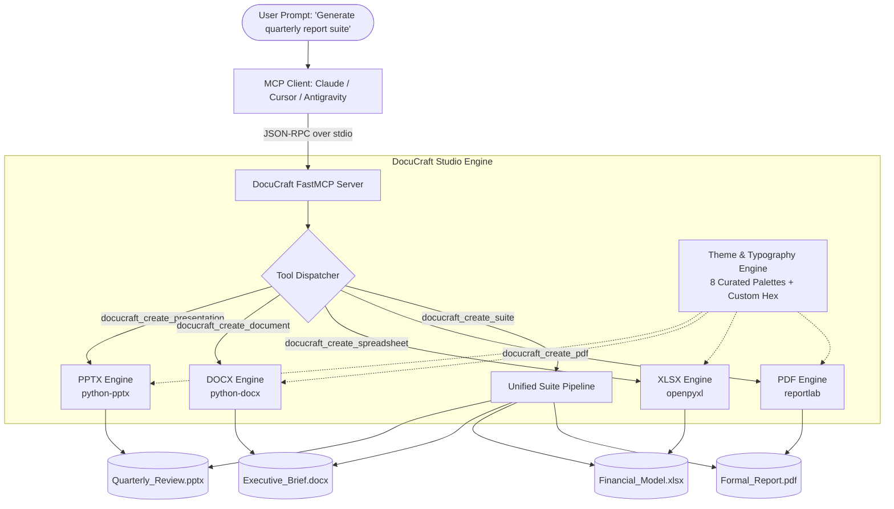

# 🎨 DocuCraft MCP

> **The Universal AI Document, Presentation, Spreadsheet & Vector PDF Studio**  
> *One Prompt, Every Format. Create beautifully styled `.pptx`, `.docx`, `.xlsx`, and vector `.pdf` files through any Model Context Protocol client.*

[](https://modelcontextprotocol.io)
[](https://www.python.org/)
[](LICENSE)
[](#privacy--security)
[](#test-suite)

---

## 🌟 What is DocuCraft MCP?

**DocuCraft MCP** empowers AI assistants (Claude Desktop, Cursor, Windsurf, Zed, Antigravity, and autonomous agent frameworks) to design and compile executive-grade documents natively in response to conversational prompts.

Instead of writing fragmented Python scripts or returning raw markdown that users must manually format, your AI can invoke **DocuCraft tools** to output publication-ready files directly onto your hard drive with unified colors, corporate typography, and consistent layouts.

---

## 🚀 Key Highlights

- **📊 Widescreen Presentations (`.pptx`)**: 16:9 modern slides with title slides, bullet cards, two-column comparisons, 3-metric KPI cards, and structured tables.
- **📝 Structured Reports (`.docx`)**: Corporate headers/footers, shaded callout boxes, zebra-striped data tables, and hierarchical typography.
- **📈 Analytical Workbooks (`.xlsx`)**: High-impact financial/project spreadsheets with header banners, 2x2 KPI highlight cards, automated `=SUM()` and `=AVERAGE()` formulas, and auto-fitted columns.
- **📄 Vector PDFs (`.pdf`)**: Precision vector layouts powered by ReportLab with dynamic two-pass `"Page X of Y"` footers, accent rules, callout blocks, and autowrapping data grids.
- **🎨 Unified Theme Engine**: 8 pre-built color palettes (`corporate_blue`, `modern_dark`, `emerald_growth`, `warm_executive`, `sunset_orange`, `royal_indigo`, `crimson_bold`, `minimal_slate`) plus support for custom hex colors and fonts.
- **📦 Enterprise Suite Generator**: Create all four file formats simultaneously with synchronized visual branding in a single prompt.
- **🔒 100% Local & Free**: Requires **zero API keys, zero cloud tokens, zero external services**. Runs entirely offline via pure Python libraries.

---

## 🏗️ Architecture



---

## 🎨 Theme & Typography Engine

Every tool accepts a `theme_name` or custom `custom_colors` hex values.

| Theme Name | Primary Accent | Secondary Accent | Background | Best For |
|---|---|---|---|---|
| `corporate_blue` | `#1E3A8A` (Deep Navy) | `#3B82F6` (Electric Blue) | `#F8FAFC` | Executive reports, board meetings, corporate pitches |
| `emerald_growth` | `#065F46` (Forest Green) | `#10B981` (Emerald) | `#F0FDF4` | ESG, sustainable finance, healthcare, biotech |
| `modern_dark` | `#38BDF8` (Sky Cyan) | `#818CF8` (Indigo) | `#0F172A` (Midnight) | Tech keynotes, AI/ML demos, developer summaries |
| `warm_executive` | `#78350F` (Amber Earth) | `#D97706` (Honey) | `#FFFBEB` | Consulting engagements, legal briefs, wealth management |
| `sunset_orange` | `#C2410C` (Terracotta) | `#F97316` (Warm Orange) | `#FFF7ED` | Marketing roadmaps, creative agencies, product launches |
| `royal_indigo` | `#312E81` (Deep Indigo) | `#6366F1` (Violet Blue) | `#F5F3FF` | Luxury brands, research institutions, academic papers |
| `crimson_bold` | `#991B1B` (Crimson) | `#EF4444` (Scarlet) | `#FEF2F2` | High-urgency alerts, quarterly reviews, cybersecurity |
| `minimal_slate` | `#334155` (Slate Navy) | `#64748B` (Cool Gray) | `#F8FAFC` | Clean technical documentation, minimal modern aesthetics |

### Custom Palette Override
Pass a custom dictionary to any generator:
```json
{
  "primary": "#4F46E5",
  "secondary": "#06B6D4",
  "background": "#FFFFFF",
  "font_primary": "Segoe UI"
}
```

---

## 🧰 Available MCP Tools

### 1. `docucraft_list_themes`
Returns all pre-configured color palettes, fonts, and suggested styling profiles.

### 2. `docucraft_create_presentation`
Generates a modern 16:9 widescreen PowerPoint `.pptx` presentation.
- **Slide Layouts supported**:
  - `title`: Presentation title, subtitle, date, and presenter.
  - `bullet`: Header with icon/bulleted highlight cards.
  - `two_column`: Side-by-side comparison with distinct card backgrounds.
  - `kpi`: 3-card metric showcase (e.g. `$4.2M (+34%)`, `99.98% SLA`, `14.2k Users`).
  - `table`: Auto-formatted data table with colored header row and alternating row zebra striping.

### 3. `docucraft_create_document`
Generates a structured Word `.docx` document.
- **Content Blocks supported**:
  - `heading1`, `heading2`, `heading3`
  - `paragraph` (with font styling and line spacing)
  - `callout` (shaded accent box with left border and indented text)
  - `bullet_list`
  - `table` (multi-column formatted tables)

### 4. `docucraft_create_spreadsheet`
Generates a formatted Excel `.xlsx` spreadsheet workbook.
- **Features**:
  - Multi-sheet support.
  - Top title banner with company/project name and subtitle.
  - 2x2 KPI summary cards with accent backgrounds.
  - Header row formatting with custom background and bold white font.
  - Auto-calculated `=SUM()` and `=AVERAGE()` total rows.
  - Currency/decimal number formatting (`$#,##0.00` or `0.0%`).
  - Automatic column width sizing.

### 5. `docucraft_create_pdf`
Generates an executive vector `.pdf` document with ReportLab.
- **Features**:
  - Dynamic two-pass `NumberedCanvas` generating `"Page X of Y"` footers.
  - Custom running header with document title and accent rule line.
  - Callout boxes with rounded accent borders.
  - Flowable tables with autowrapping text cells.

### 6. `docucraft_create_suite`
Creates all 4 files (`.pptx`, `.docx`, `.xlsx`, `.pdf`) simultaneously in one directory with unified styling.

---

## 📥 Installation

### 1. Clone the Repository
```bash
git clone https://github.com/contacttamilselvan25-lang/docucraft-mcp.git
cd docucraft-mcp
```

### 2. Set Up Python Environment
Python 3.10 or higher is recommended.

```bash
# Create a virtual environment
python -m venv venv

# Activate on Windows:
venv\Scripts\activate

# Activate on macOS / Linux:
source venv/bin/activate

# Install dependencies
pip install -r requirements.txt
```

---

## 🔌 Connecting to Your MCP Client

### Claude Desktop
Add DocuCraft to your `claude_desktop_config.json`:

- **Windows**: `%APPDATA%\Claude\claude_desktop_config.json`
- **macOS**: `~/Library/Application Support/Claude/claude_desktop_config.json`

```json
{
  "mcpServers": {
    "docucraft": {
      "command": "python",
      "args": [
        "-m",
        "docucraft_mcp.server"
      ],
      "cwd": "C:\\path\\to\\docucraft-mcp"
    }
  }
}
```

### Cursor / Windsurf / Zed
Add an MCP stdio server entry pointing to the python executable and `docucraft_mcp/server.py`:

```json
{
  "name": "docucraft",
  "command": "python",
  "args": ["-m", "docucraft_mcp.server"],
  "cwd": "/path/to/docucraft-mcp"
}
```

---

## 💡 Prompt Examples

Once connected, simply prompt your assistant naturally:

#### 📊 For a Pitch Deck:
> *"Create a 5-slide investor presentation saved to `pitch.pptx` using the `royal_indigo` theme. Include a title slide, problem/solution split column, a 3-metric KPI slide showing ARR, retention, and growth, and a roadmap table."*

#### 📝 For an Audit Report:
> *"Generate a security compliance report in `compliance.docx` using the `modern_dark` style. Add an executive callout box, risk levels table, and bulleted mitigation steps."*

#### 📈 For a Financial Model:
> *"Build an annual revenue forecasting sheet saved to `q4_forecast.xlsx` using the `emerald_growth` theme. Add 4 KPI cards at the top for Total Revenue, COGS, Net Margin, and CAC, followed by a monthly breakdown table with auto sum formulas."*

#### 📦 For a Complete Corporate Suite:
> *"Prepare a complete document bundle for 'Project Horizon' in the folder `./deliverables` using the `corporate_blue` theme. Generate the slides, report, financial spreadsheet, and PDF executive summary."*

---

## 🧪 Test Suite

DocuCraft comes with comprehensive automated tests verifying all four document generators and the theme engine:

```bash
python -m pytest tests/test_docucraft.py -v
```

Expected output:
```text
tests/test_docucraft.py::test_theme_engine PASSED
tests/test_docucraft.py::test_pptx_generation PASSED
tests/test_docucraft.py::test_docx_generation PASSED
tests/test_docucraft.py::test_excel_generation PASSED
tests/test_docucraft.py::test_pdf_generation PASSED
tests/test_docucraft.py::test_suite_generation PASSED

================ 6 passed in 3.59s ================
```

---

## 🛡️ Privacy & Security

- **100% Offline Generation**: All documents are compiled locally on your machine using standard python libraries.
- **Zero API Keys**: No external APIs or third-party cloud endpoints are contacted.
- **Zero Credentials**: Safe for confidential corporate data, financial models, and protected health information.

---

## 📄 License

This project is licensed under the [MIT License](LICENSE) - open for commercial and personal use.
